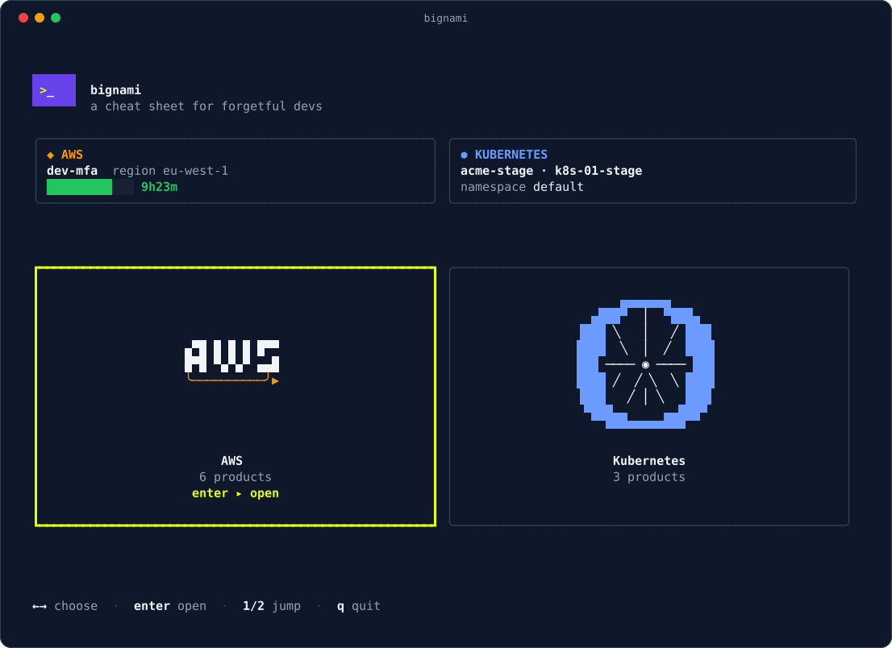
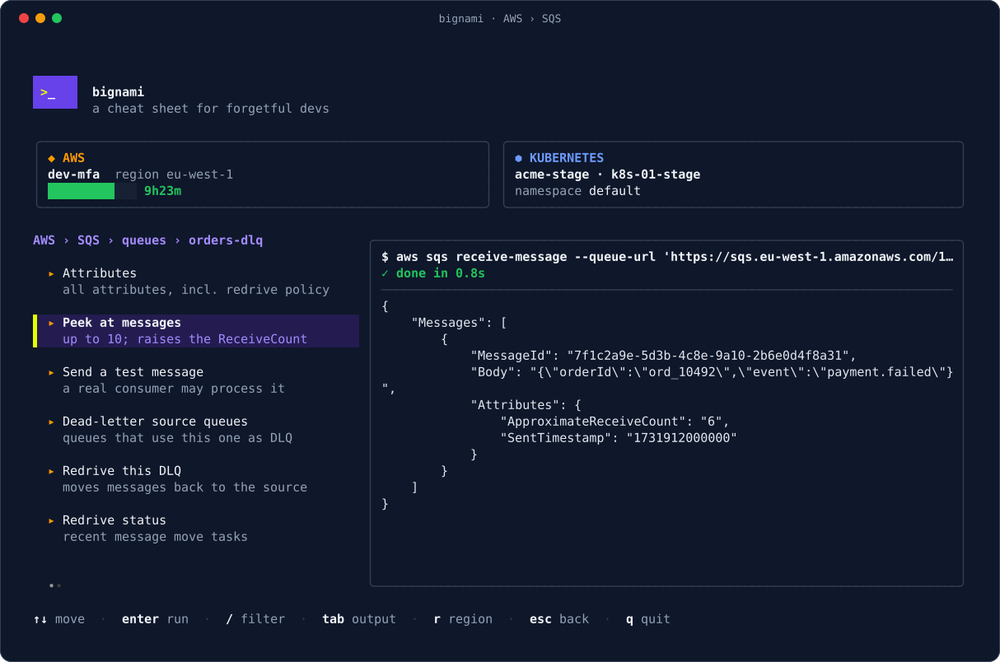
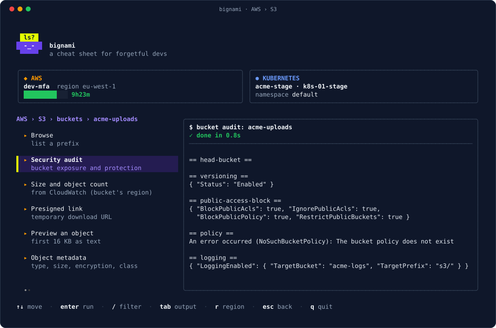

<p align="center">
  <picture>
    <source media="(prefers-color-scheme: dark)" srcset="assets/logo-dark.svg">
    
  </picture>
</p>

<p align="center">
  <b>You pick a product. You pick a command. The output appears next to the list.<br>No flags to remember, no docs to open.</b>
</p>

<p align="center">
  <a href="https://github.com/albertovincenzi/bignami/releases"></a>
  <a href="https://github.com/albertovincenzi/bignami/actions/workflows/ci.yml"></a>
  
  <a href="LICENSE"></a>
</p>

<p align="center">
  
</p>

```sh
brew install albertovincenzi/tap/bignami
```

## Why

You know what you want: "who is blocking this email address?", "why is this queue full?", "is this bucket public?". You do not remember the exact `aws` command. bignami keeps those commands for you, asks only for the values it needs, and shows the result at once.

- **Pick, do not type.** Buckets, topics, queues and roles come from a list. No ARNs to paste.
- **Safe by default.** Anything that deletes, sends or moves data asks you to type the name first. Prod contexts turn red.
- **It remembers.** The last value you typed for each prompt is already there next time.
- **Region and profile in one key.** Press `r` on any AWS screen.
- **Never in your way.** Your kubeconfig is not touched. MFA codes are not logged.

<p align="center">
  
</p>

## What it does

Two domains. Each one has products, and each product has its commands.

| Domain | Product | Commands |
|---|---|---|
| **AWS** | Session | MFA login (12h), who am I, switch profile, switch region, shell with the profile, custom `aws` command |
| | S3 | Pick a bucket: browse, security audit, size, presigned link, preview, metadata, versions, restore a deleted object, download, upload |
| | SES | Identities, suppression list (check, remove, recent), account status, test email |
| | SNS | Pick a topic: subscriptions, filter policies, attributes, test message |
| | SQS | Queues with message counts (a non-empty DLQ turns red), peek, send, redrive a DLQ, redrive status, purge |
| | IAM | My access, "can I do this?" simulation, access key age, MFA devices, roles |
| **Kubernetes** | Cluster | Switch context and namespace |
| | Workloads | Pods (logs, shell, describe), deployments, `top pods` |
| | Debug | Recent events, port-forward, custom `kubectl` command |

<p align="center">
  
</p>

## Install

You need the [AWS CLI](https://aws.amazon.com/cli/) and `kubectl` in your `PATH`. macOS and Linux are supported.

With Homebrew:

```sh
brew install albertovincenzi/tap/bignami
```

With Go:

```sh
go install github.com/albertovincenzi/bignami@latest
```

Or download a binary from the [releases page](https://github.com/albertovincenzi/bignami/releases).

## Verify a download

Each release has a keyless [Sigstore](https://www.sigstore.dev) signature of `checksums.txt`, made by the release workflow. It proves the files come from this repository. Install [cosign](https://docs.sigstore.dev/cosign/system_config/installation/), then:

```sh
v=0.2.0   # the version you downloaded
cosign verify-blob \
  --certificate-identity "https://github.com/albertovincenzi/bignami/.github/workflows/release.yml@refs/tags/v$v" \
  --certificate-oidc-issuer https://token.actions.githubusercontent.com \
  --bundle checksums.txt.sigstore.json checksums.txt
shasum -a 256 --check --ignore-missing checksums.txt
```

The binaries are not signed with an Apple Developer ID. Homebrew installs do not need that. A binary downloaded with a browser may need `xattr -d com.apple.quarantine bignami`.

## Use

```sh
bignami
```

| Key | Action |
|---|---|
| `←` `→` or `1` `2` | Choose a domain |
| `enter` | Open a domain or product, or run a command |
| `r` | Change the AWS region (AWS screens) |
| `/` | Filter the list |
| `tab` | Move the focus to the output pane (scroll with `↑↓`, `PgUp`, `PgDn`, `g`, `G`) |
| `x` | Stop the running command |
| `esc` | Go back |
| `q` | Quit (it stops running commands first) |

The output pane sits on the right when the terminal is at least 110 columns wide. On a narrow terminal it replaces the list while a command runs.

Commands that need a real terminal, such as a shell in a pod, take over the screen. When you exit them, you come back to bignami.

## AWS and MFA

The MFA login uses the profile shown in the AWS card. If you do not use `AWS_PROFILE`, it uses `default`.

1. It reads your MFA device serial with `iam list-mfa-devices`. You can set it yourself with `BIGNAMI_MFA_SERIAL`.
2. It asks for the 6-digit code and calls `sts get-session-token`.
3. It writes the session to the profile `<name>-mfa` in `~/.aws/credentials`. Only that section changes. The file keeps the mode `0600`.

A program cannot change the environment of the shell that started it. So use the new profile with `export AWS_PROFILE=<name>-mfa`, or pick "Shell with this profile".

## Safety

- bignami never changes your kubeconfig. It keeps its own context and namespace, and it passes `--context` on every call.
- If the context name contains `prod`, the card turns red. Opening a shell or running a free `kubectl` command asks you to type `prod` first.
- Commands that delete, purge, send, upload or move data ask you to type the name of the target first.
- The MFA code and the session token are never written to logs.

## Development

```sh
go test ./...
go run .
```

The code is small: `main.go` (state and keys), `domains.go` (domains and products), `aws_*.go` and `k8s.go` (the commands), `prompts.go` and `recents.go` (input), `pane.go` (the output pane), `ui.go` (the look).

The screenshots above come from the real UI with made-up data: run `scripts/shots.sh` to regenerate them.

## License

MIT
